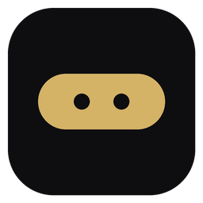
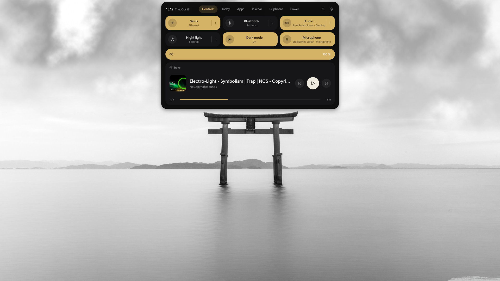
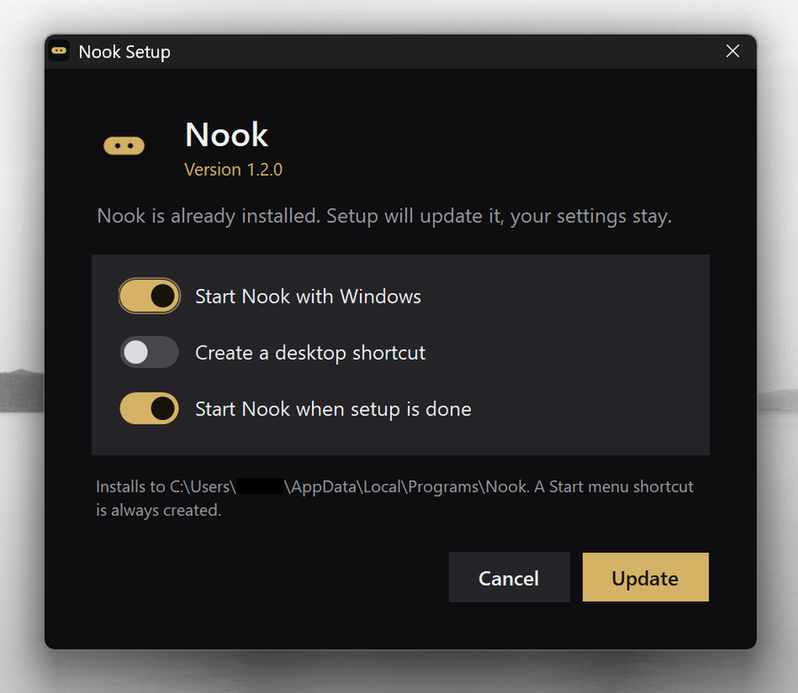
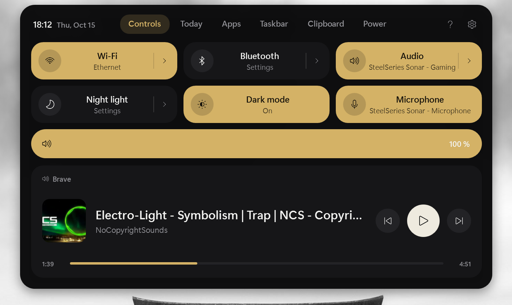
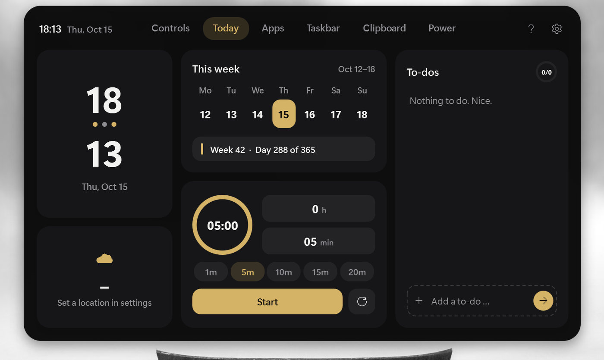
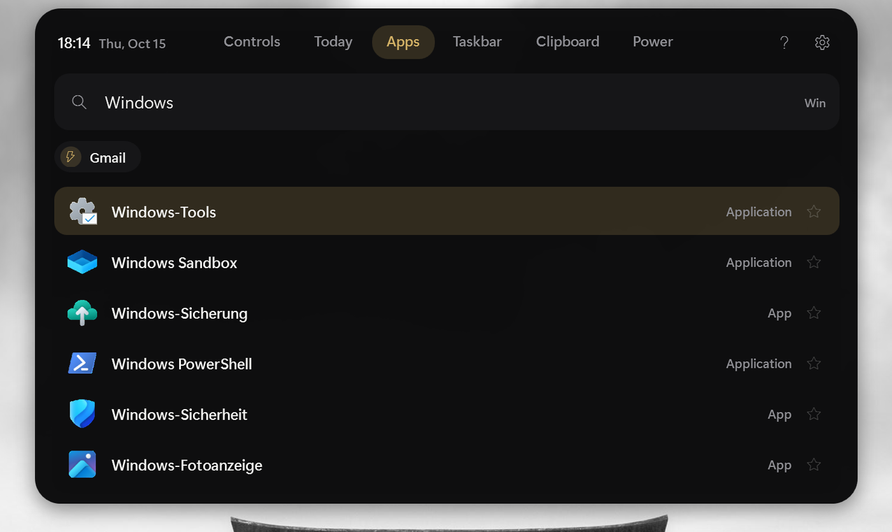
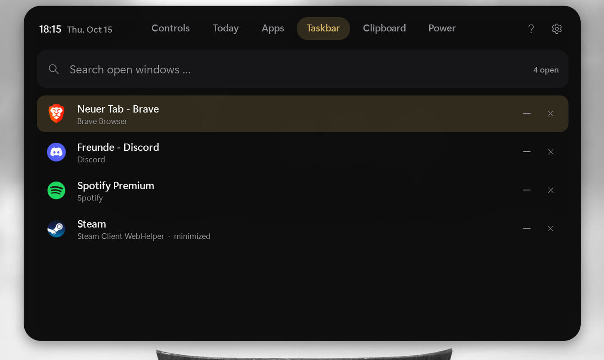
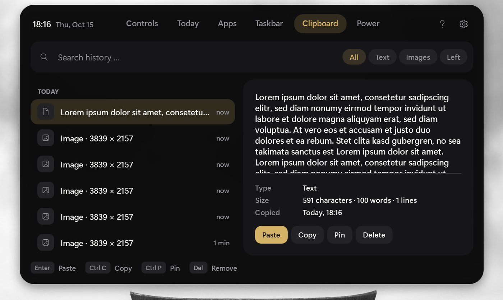
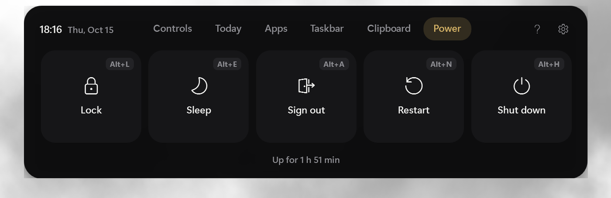

# Nook

[English](README.md) · **Deutsch**

 

Schlanker Ersatz für die Windows-11-Taskleiste: eine kleine Pille am Bildschirmrand, die per Klick oder Win-Taste zu einem Panel mit Tabs aufklappt.

## Installieren

**Mit Installer (empfohlen):** **`NookSetup.exe`** aus dem [neuesten Release](https://github.com/NixFabo/Nook/releases/latest) laden und ausführen. Ohne Administratorrechte – Nook landet nur für deinen Benutzer in `%LOCALAPPDATA%\Programs\Nook`. Setup legt eine Verknüpfung im **Startmenü** an und startet Nook auf Wunsch **mit Windows** (Desktop-Verknüpfung optional). Update: neuere `NookSetup.exe` ausführen, Einstellungen bleiben. Entfernen: *Einstellungen → Apps → Nook*.

**Portabel:** `Nook.exe` aus demselben Release in einen eigenen Ordner legen und starten.

**Selbst bauen:** Repo klonen oder als ZIP laden, `build.bat` doppelklicken – der Compiler steckt schon in Windows, es wird nichts installiert. Optional baut `installer\build-installer.bat` danach die `NookSetup.exe`.

SmartScreen-Warnung beim ersten Start: „Weitere Informationen“ → „Trotzdem ausführen“ (ohne Signatur).

**Mit Windows starten:** Rechtsklick auf die Pille → **Mit Windows starten**, oder *Einstellungen → Allgemein → Mit Windows starten*.

## Bedienen

| Aktion | Was passiert |
|---|---|
| Win-Taste allein | Panel öffnen (Start-Tab) |
| Win + andere Taste | wie immer (Win+E, Win+L, Win+Shift+S …) |
| Klick auf die Pille | Panel öffnen |
| Einfach lostippen | springt zur App-Suche (einstellbar) |
| Klick außerhalb / Esc | Panel schließen |
| Mausrad über der Pille | Lautstärke |
| Pille klicken, halten, ziehen | Pille verschieben |
| App-Icon in der Pille | Klick öffnet bzw. minimiert, Mittelklick schließt, Überfahren zeigt mehrere Fenster |
| Rechtsklick auf eine App | Aufgaben der App (z. B. „Neues Fenster“), Fenster, Schließen, Task beenden |
| Rechtsklick in der App-Suche | Öffnen, Als Administrator, Speicherort, Favorit, Deinstallieren |
| Rechtsklick auf Pille oder Panel | Einstellungen, Tastenkürzel, Task-Manager, Config-Ordner, Beenden |
| F1 im Panel | alle Tastenkürzel |

Kürzel innerhalb der Tabs liegen auf **Alt+Buchstabe**, weil normales Tippen zur Suche springt.

## So sieht es aus

| | |
|---|---|
|  |  |
|  |  |
|  |  |

## Tabs

- **Steuerung** – WLAN, Bluetooth, Audio, Nachtmodus, Dunkler Modus, Mikrofon, Lautstärke, Medien (Cover, Länge, Spulen).
  Klick auf **Audio** öffnet das Audio-Fenster: Ausgabegerät wechseln (Lautsprecher/Kopfhörer) und Lautstärke pro App.
  Klick auf **Mikrofon** schaltet es stumm; solange es stumm ist, zeigt die Pille ein rotes Mikro-Symbol (Klick darauf schaltet es wieder ein).
- **Heute** – Uhr, Woche, Timer, To-dos, Wetter.
- **Apps** – Suche mit Rechner, Favoriten, Zuletzt benutzt, Schnellzugriffe.
- **Taskbar** – offene Fenster, nach App sortiert, durchsuchbar.
- **Zwischenablage** – Verlauf mit Suche, Filtern, Anheften.
- **Power** – Sperren, Energie sparen, Abmelden, Neu starten, Herunterfahren.

## Einstellungen

Rechtsklick auf die Pille → **Einstellungen** (oder **Strg+,** im Panel). Links Suche und Bereiche, in der Mitte die Optionen, rechts die Live-Vorschau. **Speichern** (Strg+S) übernimmt sofort, **Abbrechen** (Esc) verwirft. Der Editor wird nur beim Öffnen aufgebaut und danach wieder freigegeben.

| Bereich | Was sich einstellen lässt |
|---|---|
| Allgemein | Sprache, Größe (automatisch von Full HD bis 4K), Win-Taste, zusätzliches Tastenkürzel (z. B. Strg+Alt+Leertaste), Lostippen, Windows-Taskleiste, Autostart |
| Pille | Immer / Am Rand / Aus, Höhe, Schriftgröße, Rundung, Rahmen, Reihenfolge der Inhalte, Uhr mit Sekunden, Datumsformat, Songbreite, offene Apps (zusammengefasst oder je Fenster, Icon-Größe), Maus (Klick-Tab, Mausrad, Mittelklick), Größe und Verzögerung des Strichs am Rand |
| Panel | Größe, Radius, Rahmenbreite, Tab-Stil (Pille / Linie / Text), Tab-Beschriftung (Text / Symbole / beides), Tab-Ausrichtung, Uhr, Hilfe- und Menü-Knopf, Start-Tab, Öffnen-Effekt (Morph / Blende / Gleiten / Aus), Dauer, Schattenstärke |
| Design | Vorlagen (einige mit Verlauf), alle Farben, Verlauf, Pillen- und Rahmenfarbe (oder Auto), Deckkraft, Kartenstil (gefüllt / Umriss / flach), Kartenradius, Schrift |
| Position | Rand, Ausrichtung, Abstand, Bildschirm, Verschieben |
| Tabs | Tabs an/aus und Reihenfolge, Kacheln der Steuerung an/aus und Reihenfolge, Lautstärke- und Medien-Karte, Karten unter Heute, App-Liste (Favoriten, Anzahl zuletzt benutzt, kompakt, Art), Taskbar-Gruppierung, Start-Filter der Zwischenablage, Power-Knöpfe an/aus und Reihenfolge |

**Strg+F** durchsucht alle Optionen, **Strg+Bild↑/↓** wechselt den Bereich.

Sichern oder Teilen: Rechtsklick → **Config-Ordner öffnen**. Dort liegt `config.json` (die vorige Version als `data\config.backup.json`). Eine geteilte `config.json` hineinkopieren und über das Menü **Neu laden**.

## Testversion (nebenher)

Neue Versionen lassen sich ausprobieren, ohne dein normales Nook anzufassen:

1. ZIP in einen eigenen Ordner entpacken, dessen Name „Test“ enthält, z. B. `Downloads\Nook-Test`.
2. Dort `build.bat` ausführen. Wegen des Ordnernamens entsteht **`NookTest.exe`**.
3. `NookTest.exe` starten. Sie beendet dein normales Nook und übernimmt beim ersten Start dessen Einstellungen, Favoriten, To-dos und Zwischenablage. Danach haben beide getrennte Einstellungen.
4. Zurück: Rechtsklick → **Zur stabilen Version wechseln**. Vom normalen Nook aus: Rechtsklick → **Testversion starten**.
5. Passt alles? `Nook.cs` aus dem Test-Ordner in deinen normalen Ordner kopieren und dort `build.bat` ausführen.

Die Testversion zeigt „TEST“ im Rechtsklick-Menü und ändert nie den Autostart.

## Dateien

- `Nook.cs` – das ganze Programm
- `build.bat` – baut `Nook.exe`
- `installer\` – Installer (`NookSetup.exe`) für den eigenen Benutzer
- `.github/workflows/build.yml` – baut automatisch; Tags wie `v1.0.0` erzeugen ein Release mit `NookSetup.exe` und `Nook.exe`
- `nook.ico` – Icon
- `config.standard.json` – Standardwerte zum Nachschlagen (Nook nutzt `config.json`)
- `data\` – Favoriten, Verlauf, To-dos, Zwischenablage, `error.log`

## Gut zu wissen

- Nook versteckt die Windows-Taskleiste nur und gibt ihren Platz still frei – die Desktop-Icons bleiben, wo sie sind. Beim Beenden kommt die Taskleiste zurück. Fehlt sie nach einem Absturz: Nook starten und über das Menü beenden, oder im Task-Manager „Windows-Explorer“ neu starten.
- „Task beenden“ erscheint nur, wenn es in Windows eingeschaltet ist (Einstellungen → System → Für Entwickler).
- Bluetooth und Nachtmodus öffnen die Windows-Einstellungen, statt direkt zu schalten.
- `build.bat` baut zuerst die volle Variante (Medien mit Cover und Spulen). Klappt das nicht, entsteht eine einfache Variante – der Grund steht in `build.log`.
- Die laufende Version steht unten im Rechtsklick-Menü. Fehler landen in `data\error.log`.

## Unterstützen

Nook ist kostenlos und Open Source und bleibt es auch: keine Werbung, kein Tracking, keine Bezahlfunktionen.
Wenn dir Nook gefällt, freue ich mich über einen Kaffee:

Den Link findest du auch im Rechtsklick-Menü der Pille unter **Nook unterstützen**. Ein Stern fürs Repo und Fehlermeldungen helfen genauso. Danke!

## Lizenz

[MIT](LICENSE)
